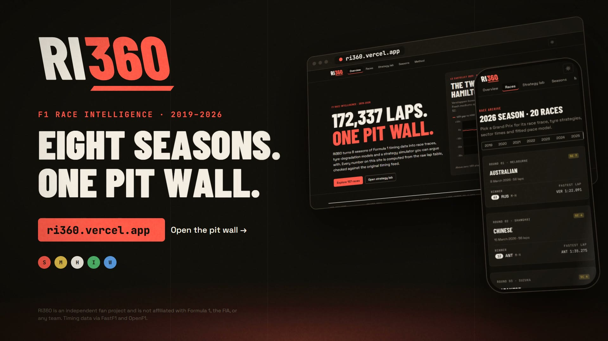
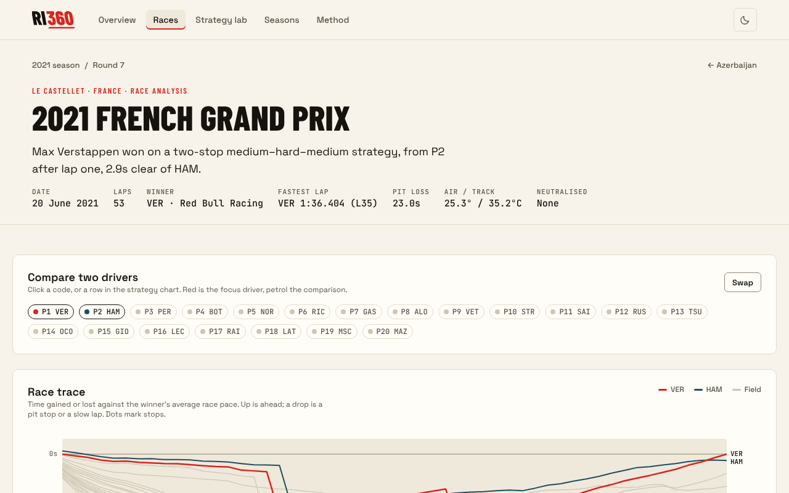

<div align="center">


# RI360 · RaceIntel360

**Every Formula 1 season since 2019, read like a pit wall.**

Race traces, tyre strategies, a fitted pace model for every race, and a strategy lab where you can re-run a Grand Prix on different tyres. All of it is built from real timing laps (172,337 across 157 races, 2019–2026), and new races are added automatically the morning after they're run.

**[Open the live site → ri360.vercel.app](https://ri360.vercel.app)**

[](https://vercel.com/new/clone?repository-url=https%3A%2F%2Fgithub.com%2FDevarsh-44%2FR1360)

</div>

### Launch film (30 s)

[](https://ri360.vercel.app/media/ri360-launch.mp4)

[Watch the 16:9 film](https://ri360.vercel.app/media/ri360-launch.mp4) · [Watch the 9:16 cut for phones](https://ri360.vercel.app/media/ri360-launch-vertical.mp4)


## What you can do

| Page | What it shows |
|---|---|
| **Overview** | Headline findings from the data: what a pit stop costs at each circuit, how fast each tyre compound wears, and who dominated each season. |
| **Races** | Every race since 2019 (2021 has rounds 1–7 only, see below). Each one has a race trace, lap times, running order, every driver's tyre stints, the results with clean-air pace, best sectors, and a pace model checked against the real laps. |
| **Strategy lab** | Choose a race and a driver, plan the stints yourself, and see the predicted race time lap by lap. It also finds the fastest one-stop and two-stop plans. |
| **Seasons** | A heat map of every driver's result, or pace, in every round. |
| **Method** | How the data was cleaned and checked, how the model works, and its limits. |

It works on desktop and phone, in a light **paper** theme and a dark **pit wall** theme.

<table>
  <tr>
    <td width="66%"></td>
    <td></td>
  </tr>
  <tr>
    <td></td>
    <td></td>
  </tr>
</table>

## Quick start

You need [Node.js 20.19 or newer](https://nodejs.org) for the website. Python 3.10 or 3.11 is only needed for the API and the data scripts.

```bash
git clone https://github.com/Devarsh-44/R1360.git
cd R1360/frontend
npm install
npm run dev
```

Open http://localhost:3000. The website needs no server or database, because all its data ships with it in `frontend/public/data`.

### Run the API (optional)

```bash
cd R1360/backend
python -m venv venv
source venv/bin/activate          # Windows: venv\Scripts\activate
pip install -r requirements.txt
uvicorn api.main:app --reload --port 8000
```

Interactive API docs are then at http://localhost:8000/docs. Settings live in `backend/config/config.example.env`: copy it to `.env` if you need to change the database or add an OpenAI key. Never commit `.env`.

## Put it online (Vercel)

1. Click **Deploy with Vercel** above, or go to [vercel.com/new](https://vercel.com/new) and import this repository.
2. Leave **Root Directory** empty and click **Deploy**. The included `vercel.json` already tells Vercel how to build the site.
3. You get a live `*.vercel.app` link in about a minute. Every push to `main` updates it.

To add your own domain, open the project on Vercel and go to **Settings → Domains**. More detail, including hosting the API, is in [docs/DEPLOY.md](docs/DEPLOY.md).

## Project structure

```
R1360/
├── frontend/                 The website (React + TypeScript + Vite)
│   ├── public/data/          Race data the site reads (generated, see below)
│   └── src/
│       ├── pages/            Overview, Races, Race, Strategy lab, Seasons, Method
│       ├── charts/           Hand-built SVG charts
│       ├── lib/              Data loading, formatting, pace model, routing
│       └── styles/           RI360 design tokens and styles
├── backend/                  Python: API, data pipeline, models
│   ├── api/                  FastAPI app and routes
│   ├── data_pipeline/        Fetch F1 data, build the dataset and the site data
│   ├── strategy/             Strategy simulator
│   ├── scripts/              Model training and helper scripts
│   ├── data/                 Lap table, OpenF1 race snapshots, race IDs, known gaps
│   ├── cache/                FastF1 timing cache (2019–2023 source)
│   ├── models/               Model feature list
│   └── config/               Example settings and database schema
├── docs/                     Deploy guide, mobile-app guide, screenshots, launch poster
├── .github/workflows/
│   ├── ci.yml                Checks that the site builds and the API starts
│   └── update-data.yml       Adds each new race to the site every morning
└── vercel.json               Vercel build settings
```

## How the data is made

There are two data sources:

- **2019–2023:** [FastF1](https://github.com/theOehrly/Fast-F1). `backend/data_pipeline/fetch_f1_data.py` downloaded the timing into `backend/cache/`, and `build_dataset.py` turned it into the lap table `backend/data/lap_model_dataset.csv`. The F1 live-timing archive behind FastF1 now requires an F1TV login, so these races are kept as they are.
- **2024 onward:** [OpenF1](https://openf1.org), which is free and needs no account. `backend/data_pipeline/openf1_source.py` saves each finished race as a small snapshot in `backend/data/openf1/<year>/`.

`backend/data_pipeline/update_site_data.py` puts it together. It:

1. downloads every finished race that isn't saved yet
2. adds the 2024+ laps to the lap table, with fixed race IDs (`backend/data/race_ids.json`) so race links never change
3. runs `build_site_data.py`, which removes duplicate laps, rebuilds tyre ages, cross-checks the FastF1 laps against the raw timing feed, fits a pace model for each race, and writes `frontend/public/data/`
4. checks that every finished race since 2019 is on the site, apart from the ones listed in `backend/data/known_gaps.json`

```bash
cd backend
python data_pipeline/update_site_data.py            # fetch new races and rebuild
python data_pipeline/update_site_data.py --offline  # rebuild from saved data only
```

### Automatic updates

The [Update race data](.github/workflows/update-data.yml) workflow runs every morning at 06:00 UTC. When a race has finished, it downloads it, rebuilds the site data and pushes a commit to `main`, and Vercel then redeploys the site. On other days it commits nothing. If a finished race is still missing, the run fails and GitHub emails you. You can also start it by hand from the **Actions** tab.

## Turn it into a mobile app

The website already runs inside an app wrapper with no code changes: it uses relative paths, hash-based page URLs, offline data, and phone-sized layouts. [docs/MOBILE.md](docs/MOBILE.md) has step-by-step instructions to package it for iOS and Android with Capacitor.

## Built with

- **Website:** React 18, TypeScript, Vite, d3-scale and d3-shape
- **Fonts:** Barlow Condensed, Space Grotesk and JetBrains Mono, from the RI360 design system
- **Backend:** Python, FastAPI, SQLAlchemy, FastF1, pandas, scikit-learn
- **Hosting:** Vercel (website), any Python host (API)

## Troubleshooting

| Problem | Fix |
|---|---|
| `npm run dev` fails with a Node version error | Install Node 20.19+ (the repo includes `frontend/.nvmrc`, so with nvm just run `nvm use`). |
| Port 3000 is busy | `npm run dev -- --port 3001` |
| API routes say the model file is missing | Train it first: `cd backend && python scripts/train_model.py` |
| `pip install` fails on Python 3.12+ | Use Python 3.10 or 3.11 (pinned in `backend/runtime.txt`). |

## Credits

Timing data comes from the FastF1 library (Formula 1 live-timing archive) for 2019–2023 and from [OpenF1](https://openf1.org) from 2024 onward. RI360 is an independent project and is not affiliated with Formula 1, the FIA or any team. Formula 1 and related marks are trademarks of their owners.
